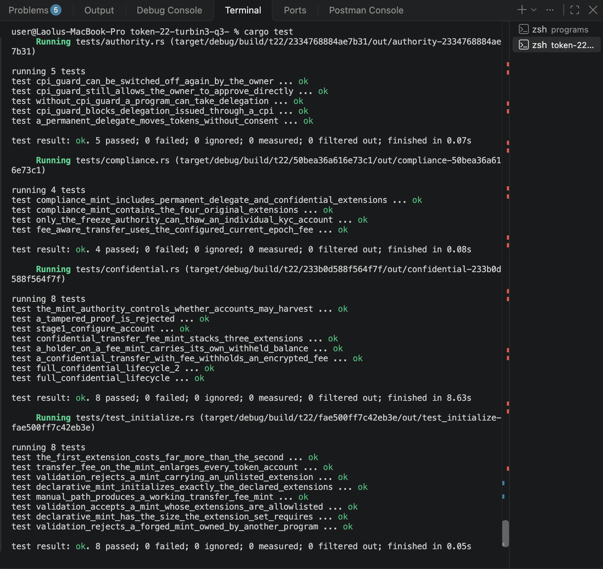

# Token-2022 Extensions on Anchor

T22 is a Solana program built with the Anchor framework and SPL Token-2022. It explores how regulated token systems can combine compliance controls, transfer fees, account restrictions, and confidential transfers.

The project addresses a key challenge in blockchain-based financial systems: regulators may require issuers to identify, restrict, or seize funds belonging to sanctioned users, while token holders may require transaction amounts and balances to remain private.

T22 brings these requirements together through Token-2022 extensions and confidential-transfer instructions.

---

Key Features

1. Token-2022 Compliance Mint

The program supports compliance-oriented mint creation using Token-2022 extensions.

The compliance configuration includes:

TransferFeeConfig- Applies configurable fees to token transfers.
MetadataPointer- Provides a pointer to token metadata.
DefaultAccountState- Allows new token accounts to start in a frozen state.
MintCloseAuthority- Provides an authority for closing an eligible mint.
PermanentDelegate- Gives the designated authority special control over token accounts.
ConfidentialTransferMint- Enables confidential token-transfer functionality.

The program calculates the required mint account size from its selected extensions rather than relying on a hard-coded account size.

2. Transfer Fee Management

T22 supports Token-2022 transfer fees.

The program reads the mint's transfer-fee configuration and uses the current epoch to determine the applicable fee.

Transfers use the fee-aware Token-2022 instruction:

transfer_checked_with_fee

This ensures that the transfer includes the expected fee rather than relying on an ordinary checked transfer that does not explicitly validate the fee amount.

3. KYC and Account Restrictions

The compliance design uses DefaultAccountState to initialize new token accounts in a frozen state.

This prevents accounts from immediately participating in ordinary token transfers.

After the required identity verification and compliance checks, the authorized freeze authority can thaw an eligible account.

This provides a basic mechanism for restricting token activity until an account satisfies the issuer's requirements.

4. Permanent Delegate and Seizure Authority

The PermanentDelegate extension provides an issuer-designated authority with special control over token accounts.

It can be used to transfer or burn tokens from ordinary token-account balances without requiring the token holder's approval.

This supports the project's regulatory scenario in which an issuer must be able to act against sanctioned wallets.

However, this authority has an important limitation when combined with confidential transfers.

5. Confidential Transfers

T22 explores confidential token transfers through the Token-2022 Confidential Transfer extension.

The confidential-transfer workflow includes:

Configure a token account for confidential transfers.

Obtain the required account approval.

Deposit public token balances into the confidential system.

Apply pending confidential balances.

Transfer tokens confidentially.

Withdraw confidential balances back into the public token balance.

Confidential transfers rely on cryptographic proofs to validate transactions without publicly revealing the transfer amount.

The proof-generation process is performed by the client, while the on-chain program and Token-2022 program validate the required proof accounts and instructions.

6. Confidential Transfer Fees

The project also explores combining transfer fees with confidential transfers.

Token-2022 provides the ConfidentialTransferFeeConfig extension for confidential transfer-fee handling.

This introduces additional configuration and authority requirements, including the ElGamal public key used for confidential withheld-fee management.

The confidential fee configuration must be included when calculating the required mint size and initializing the relevant extensions.

Confidential Transfer Lifecycle

The intended confidential-transfer lifecycle is:

Create Confidential Mint
          |
          v
Create Token Account
          |
          v
Configure Confidential Account
          |
          v
Approve Confidential Account
          |
          v
Deposit Public Tokens
          |
          v
Apply Pending Balance
          |
          v
Confidential Transfer
          |
          v
Apply Pending Balance
          |
          v
Withdraw Confidential Tokens

The client must maintain the information needed to calculate updated encrypted balances and generate valid zero-knowledge proofs.

The on-chain program cannot independently decrypt a holder's confidential balance.

### Test

| `test_initialize.rs` | 8 | Declarative vs. manual mint sizing, exact extension sets, allowlist accept/reject, forged-mint rejection |
| `compliance.rs` | 4 | Compliance mint extensions, freeze-authority-only thaw, fee-aware transfers |
| `confidential.rs` | 8 | Full confidential lifecycle with real proofs, tampered-proof rejection, three-extension fee mint, harvest toggle, encrypted fee withholding |
| `authority.rs` 5 | CPI Guard on/off/owner-direct, permanent delegate seizure |

All 25 tests pass:

